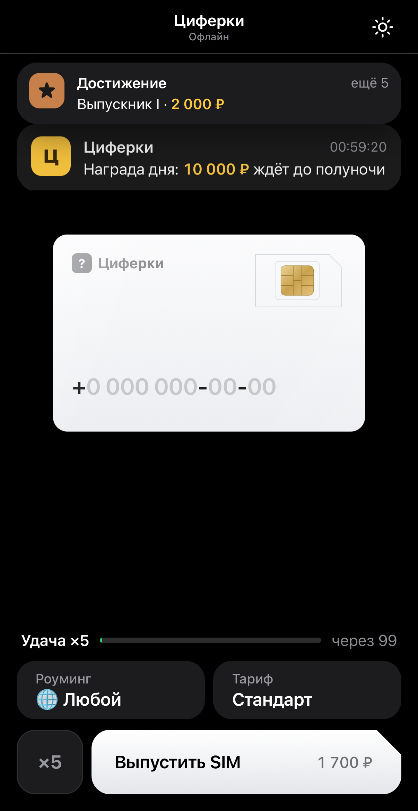
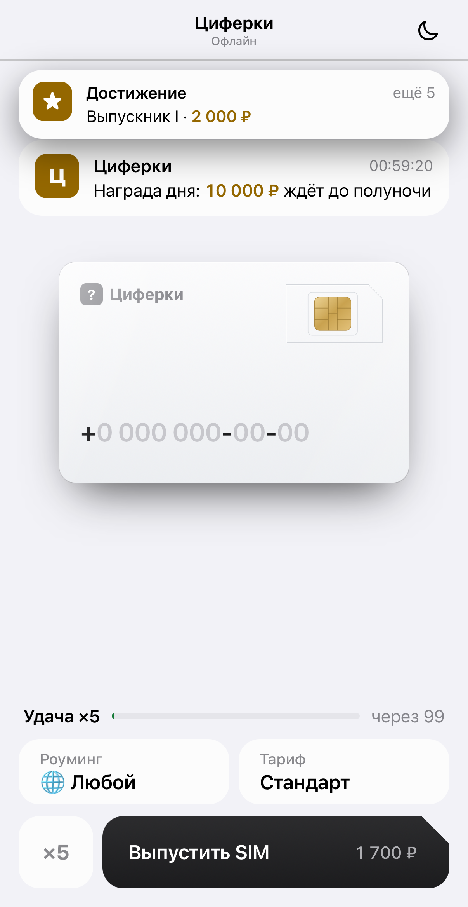

# Циферки Offline для iPhone

Офлайн-версия игры «Циферки» с локальным сохранением, встроенными ресурсами и интерфейсом для телефона. Telegram и подключение к Интернету не нужны.

**[Скачать unsigned IPA v1.1.0](https://github.com/Bourbon24k/CiferkiOffline/releases/tag/v1.1.0)** · [Подробное описание и отличия от оригинала](outputs/CiferkiOffline/README.md)

IPA требуется подписать перед установкой. Минимальная версия — iOS 16. Установка на физический iPhone пока не проверялась.

## Скриншоты

Тёмная тема включена по умолчанию. Переключение темы сохраняется; кнопка «Назад» возвращает внутри игры. Скриншоты сделаны в iOS Simulator.

<table>
<tr><th>Тёмная тема</th><th>Светлая тема</th></tr>
<tr><td></td><td></td></tr>
</table>

## Возможности

- Выпуск SIM, тарифы, коллекция, продажа и оформление номеров.
- Награды, навыки, достижения, сезонный пропуск и магазин.
- Телефоны, салоны и мини-игры.
- Локальные рынок, аукционы и рейтинг с виртуальными участниками.

Все покупки используют игровую валюту. Новый профиль начинает с 50 000 игровых рублей; промокод **OFFLINE** даёт 100 000 рублей и 3 билета «Премиум» один раз.

## Сборка и проверки

Откройте `outputs/CiferkiOffline/CiferkiOffline.xcodeproj` в Xcode или выполните на Mac:

```sh
cd outputs/CiferkiOffline
./build-unsigned.sh
node --test tests/*.test.cjs
```

Версия 1.1.0: 34 Node-теста и 6 интеграционных XCTest прошли. На iPhone 18 Pro / iOS 27.0 проверены 27 экранов в обеих темах, сохранение, навигация и блокировка внешнего fetch. Компактный размер 375 × 667 проверен в браузере. Нативная проверка iPhone SE не завершилась из-за сбоя загрузки симулятора.

## Происхождение

Это неофициальная реконструкция. Интерфейс и публичные ресурсы происходят из доступной веб-игры «Циферки»; авторство оригинальной игры не заявляется. Серверных исходников нет, поэтому часть алгоритмов и экономики восстановлена приблизительно. Подтверждённое совпадение серверной логики 1 в 1 не заявляется. Живые аккаунты и настоящие игроки не используются.
